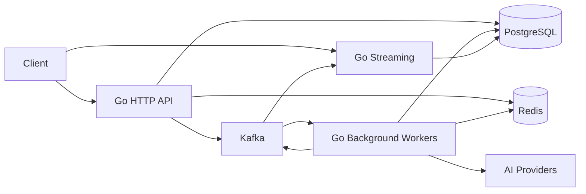

# GoForge — AI Backend Platform Architecture

GoForge carries forward the original RustForge product architecture in Go: an AI backend platform combining APIs, background workers, streaming, PostgreSQL, Redis, Kafka, and AI providers.

The project covers backend development, concurrency, databases, distributed systems, AI infrastructure, and production engineering. Document processing can be an example workload; the platform architecture is not limited to it.

## Implementation status

This document describes the target architecture. Currently, only the Go HTTP API starter, health endpoint, logging, timeouts, and graceful shutdown exist. Workers, streaming, databases, messaging, and AI integrations remain to be implemented.

## Platform overview

```text
                         GoForge
                            |
             +--------------+--------------+
             |              |              |
             v              v              v
          Go API        Go Background   Go Streaming
                           Workers
             |              |              |
             +--------------+--------------+
                            |
                  Platform integrations
                            |
             +--------------+--------------+
             |              |              |
             v              v              v
         PostgreSQL       Redis          Kafka
                            |
                      AI Providers
```

The integrations above are shared platform capabilities, not a sequence of network calls. Each component uses the integrations required by its workload. For example, workers call AI providers directly; those calls do not pass through Redis.



## Components

| Component | Responsibility | Go implementation direction |
| --- | --- | --- |
| API | Accept requests, authenticate callers, validate input, submit jobs, and expose status and results | HTTP handlers using `net/http`; propagate request contexts and deadlines |
| Background workers | Execute AI jobs outside the request lifecycle, persist results, and publish progress | Separate worker entry point with bounded goroutines and explicit job cancellation |
| Streaming | Deliver progress and incremental results to connected clients | Start with server-sent events over HTTP; stop work when clients disconnect |
| PostgreSQL | Persist application records, job state, results, and events awaiting publication | Transactions, migrations, and connection pooling |
| Redis | Cache reusable data and coordinate distributed rate limits | Expiring keys; PostgreSQL remains the durable source of truth |
| Kafka | Distribute asynchronous jobs and progress events, with replay where required | Explicit consumer groups, event versions, and acknowledgement after durable processing |
| AI providers | Perform inference through external APIs | A small Go interface with provider-specific adapters, deadlines, and error handling |

## Example job lifecycle

1. The API validates a request and records a pending job in PostgreSQL. The same transaction records an outbox event for later publication.
2. An outbox publisher sends the job event to Kafka. Publication can be repeated after failures, so consumers must handle duplicates.
3. A worker consumes the event and checks the persisted job state before executing it. Concurrent deliveries must not independently execute the same job; use a transactional claim with a lease and recovery rules.
4. The worker calls the AI provider with a deadline and bounded concurrency. Retry transient failures with backoff and a maximum attempt count.
5. The worker persists progress or a terminal result and an associated outbox event in PostgreSQL before acknowledging the consumed event.
6. Streaming consumers deliver progress events to connected clients. Clients can retrieve persisted job status after reconnecting.

External AI calls may still be repeated if a worker fails after the provider completes but before the result is saved. Use provider idempotency keys where supported, and account for possible duplicate cost otherwise.

## Go structure

Begin with one repository. The API and streaming handlers can share a process, while workers run independently. Split services further only when deployment or scaling needs justify it.

```text
cmd/
  api/                 API and streaming server (starter exists)
  worker/              Background worker entry point (planned)
internal/
  config/              Environment configuration (planned)
  httpapi/             Routes, handlers, middleware, streaming (planned)
  jobs/                Job lifecycle and application logic (planned)
  storage/             PostgreSQL persistence and outbox (planned)
  cache/               Redis integration (planned)
  messaging/           Kafka publication and consumption (planned)
  ai/                  AI provider interface and adapters (planned)
migrations/            Database schema migrations (planned)
docs/
  architecture.md      Target architecture
```

Use contexts for cancellation and deadlines, bounded worker concurrency, and explicit ownership of goroutines. During shutdown, stop accepting work, drain active requests or jobs within a deadline, then close database and messaging clients. Streaming handlers will need separate timeout rules from ordinary API requests; the starter's fixed write timeout is not a final streaming configuration.

## Production requirements

- Authentication, authorization, input limits, and per-user or per-tenant quotas.
- Idempotent job submission, durable job state, controlled retries, and handling for exhausted jobs.
- Structured logs, request and job identifiers, metrics, and tracing across asynchronous work.
- Health and readiness checks, configuration validation, and secrets supplied through the runtime environment.
- Integration tests for persistence and messaging, failure recovery checks, and load tests with measured latency and throughput.

## Delivery stages

1. **API and persistence:** add PostgreSQL, migrations, job submission, and job status.
2. **Background execution:** add a worker, AI provider adapter, timeouts, retries, and durable results. A PostgreSQL-backed job claim can support the first working version.
3. **Streaming:** expose job progress and reconnect behavior over HTTP.
4. **Redis:** add caching and distributed rate limiting with explicit expiration and failure behavior.
5. **Kafka:** introduce asynchronous event distribution and the transactional outbox, then verify duplicate handling and recovery.
6. **Operations:** complete authentication, observability, deployment configuration, and performance validation throughout these stages.

PostgreSQL, Redis, Kafka, streaming, and AI providers remain part of the target platform. The stages describe implementation order.
